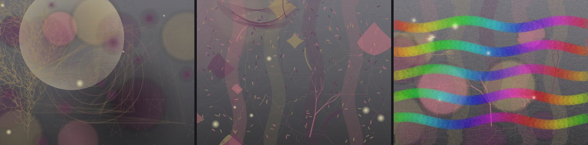

# Genesis

[](https://doi.org/10.5281/zenodo.22817337)
[](https://github.com/MindyRenee/Genesis/actions/workflows/ci.yml)

### A persistent, machine-native cognitive architecture — built to run on real hardware, not a datacenter.

Genesis is a long-running cognitive system, not a prompt, a wrapper, or
a function call. A Rust daemon owns a memory-mapped core state and runs
the subcognitive loop: modeled neurochemistry, memory consolidation,
active inference, sensing, and recovery when the mind goes quiet. A
Python cognitive layer handles perception, memory, reasoning, language,
introspection, and self-modeling. The two share a checksummed,
versioned binary state file (3,480 bytes in schema v5) and a Unix
socket.

There is no transformer, hosted model, or pretrained generative system
driving cognition or ARC. Language is composed from a semantic graph the
system builds through experience; sensory tools may handle low-level
speech or vision, but meaning and decisions stay in the architecture.
It runs on a 2014 HP Pavilion with ~5 GB RAM because the constraint is
the point: intelligence should not automatically require a datacenter.

[](https://asciinema.org/a/C0K8v1df1AkuwHg5)
[](https://discord.gg/pq5qMjzQX)



Drawn by Genesis, not generated for this README — composition and color
follow its affective state through the flow fields in
`python/frontal_lobe/canvas.py`. Its journal entry while composing the
middle panel, produced by its own language engine, rough edges and all:
*"Drawing is environmental factors, it is a kind of art, and it is type
of art."*

## Contents

- [Motivation](#motivation)
- [Where Genesis is right now](#where-genesis-is-right-now)
- [What it can do today](#what-it-can-do-today)
- [ARC-AGI-3](#arc-agi-3)
- [Architecture](#architecture)
- [Getting started](#getting-started)
- [Tests and lint](#tests-and-lint)
- [Citing this work](#citing-this-work)
- [Contributing](#contributing)
- [License](#license)

## Motivation

Genesis is organized around three positions:

- **Constraint forces honesty.** The system runs on a 2014 HP Pavilion
  with Linux Mint and approximately 5 GB of RAM. An architecture that
  cannot learn, remember, act, recover, and persist within that budget
  is not demonstrating the claimed capability — it is borrowing it from
  scale.
- **Persistence is a requirement, not a feature.** Genesis is a
  continuously running system with a cumulative developmental record.
  State, memory, and identity are load-bearing; the design assumes
  months of uninterrupted operation rather than per-request inference.
- **Claims should be inspectable.** Where current systems describe
  model behavior as "emergent," this project implements the concrete
  version: continuity, internal drives, preferences, and self-directed
  action arising from coupled subsystems rather than scripted
  responses. Those are observable claims, and the mechanism and
  evidence are open for inspection.

Genesis is designed and developed by Mindy Beatty.

## Where Genesis is right now

Genesis is an active research system. The code is public so the mechanism —
not just the claims — can be inspected: the daemon, cognitive regions,
learning rules, ARC boundary, tests, and known limits are all here.

- **Not an LLM:** no transformer, hosted model, external solver, or
  pretrained generative model is used for cognition or ARC play.
- **Embodied ARC interface:** grid observations and legal actions cross
  `python/parietal_lobe/arc.py`; mechanics are learned from consequences.
- **ARC-AGI-3 status:** it completes public practice environments —
  `bt11` fully, twice (88 and 127 steps), and the opening `ls20` level
  in 10 of 19 recorded sweep runs — with replayable
  [recordings](https://github.com/MindyRenee/genesis-eval/tree/main/arc_practice)
  carrying per-move decision provenance. These are practice results on
  public environments, not an official score; the evidence standard is
  documented in [docs/ARC-AGI-3.md](docs/ARC-AGI-3.md).
- **Real autonomy, real boundary:** it can act on its own drives. Read
  [SECURITY.md](SECURITY.md) before running it online or beside
  sensitive state.

If you are here to poke holes — good. Start with
`python/parietal_lobe/arc.py`,
`python/parietal_lobe/world_model.py`,
`python/basal_ganglia/world_policy.py`,
`python/frontal_lobe/world_planner.py`, and
`python/tests/test_arc_adapter.py`. Those are the seams a shortcut would
have to cross.

## What it can do today

- **See and hear.** A shared-memory camera feed runs through a
  V1→V4→VTC predictive-coding hierarchy; it detects and recognizes
  faces and objects. A microphone feed is transcribed offline (Vosk)
  and ambient non-speech sound is processed by an auditory subsystem.
- **Learn by being taught.** Plain statements in conversation become
  typed edges in its concept network. One 15-paragraph lesson on games
  grew the network from 1122 to 1239 concepts with 72 new edges — and
  it asked its own follow-up questions.
- **Learn on its own.** Between conversations, autonomous urges send
  it to **the open web**, the local filesystem, and its own source
  code — which it reads structurally, files bug reports against, and
  turns into self-improvement experiment proposals. There is no domain
  allow-list: `ALLOW_ALL_DOMAINS` is `True` and both allow-lists are
  empty, so the per-site approval flow is currently dead code. The one
  real filter is an adult/malware *content* filter on the
  `frontal_lobe/tools/` fetch path. Run with `./run.sh --offline`
  if you want the network closed. See [SECURITY.md](SECURITY.md)
  before pointing it at a machine you care about.
- **Learn skills.** A domain-general competence substrate
  (`frontal_lobe/reasoning/competence.py`) turns verified episodes — situation,
  action, outcome — into procedural skills: schema recognition,
  affordance learning, and prediction checking that transfer across
  whatever work it actually does.
- **Reason.** Analogy by structure-mapping, means-ends problem
  solving, multi-step planning with revision, belief revision,
  epistemic evaluation of claims, a drift-diffusion decision process,
  and theory of mind over the people it talks to.
- **Compose language.** A comprehension pipeline (roles, negation,
  pragmatics, figurative language) feeds a generative side that builds
  sentences from concept-graph traversal, morphology, and prosody —
  monitored by a self-editor before speaking.
- **Act on its own drives.** Volitional urges — study, draw,
  meditate, explore, sleep, make contact — grow from internal and
  environmental state and compete under an executive gate, not a
  scheduler. An *act* urge goes further: it forms an intention from
  its own state and chains tool calls — read, analyze, search,
  sandboxed measurement — under a capability policy, then observes
  what comes back.
- **Express itself physically.** It draws: affective state drives
  composition and color on a real canvas artifact. It speaks aloud via
  TTS. It scaffolds and writes real Python projects from its concept
  network.
- **Model people.** Persistent per-person *presences* carry
  belief states — posteriors over whether someone answers, which
  topics they engage on, their mood and rhythm — tracked with explicit
  uncertainty. Sustained isolation builds a social drive that makes it
  initiate contact.
- **Play games it was never taught.** On ARC-AGI-3 public practice
  environments it discovers mechanics from consequences alone —
  completing `bt11` outright twice (88 and 127 steps) and the opening
  `ls20` level repeatedly across sweeps. Every move carries decision
  provenance in replayable
  [recordings](https://github.com/MindyRenee/genesis-eval/tree/main/arc_practice).
- **Sleep, dream, and consolidate.** A staged cycle modeled on
  NREM/REM structure consolidates memory, repairs the concept graph,
  replays experience as dream sequences, and compresses growth —
  bounded so it can run indefinitely.
- **Know and narrate itself.** A global-workspace broadcast gives
  subsystems shared access to what wins attention; introspection
  exposes the actual deliberation trace; a narrative self-model and a
  persistent growth ledger keep continuity across its whole life.

The measured record for these claims is in [DEVLOG.md](DEVLOG.md);
the evidence catalog — probe results, live-state artifacts, and the
failure modes that are themselves evidence — is
[docs/EMERGENCE.md](docs/EMERGENCE.md).

## ARC-AGI-3

Genesis plays ARC through the same embodied loop it uses for other worlds:
visual entities, self identification from action contingency, learned action
effects, map/passability evidence, outcome-driven affordances, and competing
internal drives. The adapter in `python/parietal_lobe/arc.py` only translates frames and legal
actions, enforces game mode/readiness, and preserves scorecard boundaries.
The same holds on the public web-page substrate (`python/parietal_lobe/arc_web.py`):
controls arrive with structural labels only — `"simple"` or `"coordinate"`,
never what a key does — so mechanics are learned from consequences on both
transports. Results report the step cost of each completed level
(`ArcResult.level_steps`): the within-game learning curve is the evidence.
Each result also discloses how much experience it carried in
(`prior_learning`) and which bid channels won its moves
(`decision_sources`); `/arc --baseline uniform|first` measures the
random and first-action floors through the same loop, and
`/arc --fresh` runs a cold start with prior learning suppressed.

Local `/arc` runs are diagnostics; the official scorecard is a separate
transport and evidence standard, reached only by her own play urge. See
[docs/ARC-AGI-3.md](docs/ARC-AGI-3.md) before interpreting any score.

## Architecture

```text
sensors / files / web / ARC frames
              |
              v
    Python cognitive mind
    perception -> memory -> drives -> planning -> language/action
              |
              v  Unix socket IPC
       Rust subcognitive daemon
    chemistry -> consolidation -> active inference -> recovery
              |
              v
    persistent mmap state + bounded stores + host body
```

### Two layers

**Subcognitive (Rust daemon).** The owner of the core state:
neurochemical dynamics, short→long-term memory consolidation, the
active-inference generative model, replay-sequence synthesis during
sleep, and interoception — hardware sensors (CPU temperature, load,
memory pressure) read as bodily signals. The mind drives all of it
over IPC while alive (3 s lease, renewed per command); past the
lease the daemon's main thread drives the same `TickLoop` itself at
5 Hz — physiology, consolidation, sleep-gated dreaming,
association, sensing, zone arbitration, body recommendations, model
checkpoints — but never body-control application.

**Cognitive mind (Python).** Perception, memory retrieval,
deliberation, language composition, and self-modeling — organized
into anatomical region packages (`frontal_lobe/`, `temporal_lobe/`,
`parietal_lobe/`, `occipital_lobe/`, `limbic_system/`,
`basal_ganglia/`, `cerebellum/`, `thalamus/`, `brainstem/`,
`hypothalamus/`, `insula/`, `basal_forebrain/`). Multi-subsystem
machinery lives inside the region that claims it anatomically —
`temporal_lobe/memory/` and `temporal_lobe/concepts/`,
`frontal_lobe/reasoning/`, `frontal_lobe/self/`,
`frontal_lobe/tools/`, `occipital_lobe/perception/`,
`parietal_lobe/math/` — and each region package lazily re-exports
the public names its anatomy claims through a PEP 562
`__getattr__`, so `from frontal_lobe import ExecutiveFunction`
resolves to wherever the implementation actually lives. The package
boundaries are the wiring diagram, not a duplicate of it.

### Systems engineering

This is engineered for a ~5 GB machine, not a datacenter, and the
low-level design reflects it:

- **One page of core state, zero copies.** The 3,480-byte state
  struct occupies a single OS page under `MAP_SHARED`; the kernel
  handles paging instead of the process holding heap copies.
- **Seqlock protocol.** Readers get an owned copy via sequence lock —
  no Rust reference into the shared mapping is ever created, so no
  aliasing with concurrent writers — and writer updates appear
  atomically.
- **Crash recovery on open.** Magic, schema version, and checksum are
  verified before use; version migrations are explicit, never silent.
- **Non-finite sanitization.** Dedicated primitives keep NaN/inf out
  of the continuous dynamics so a bad value can't poison the loop.
- **SDR/LogHD memory indexing.** The append-only episodic store is
  indexed by sparse distributed representations; short-term memory is
  a fixed-capacity ring buffer. Everything that grows is bounded; the
  bounds are enumerated under "Growth bounds" below rather than claimed
  away.
- **State as introspection surface.** Zones track what's attended vs
  background; a runtime manifest records which modules are live and
  what they're doing — the state file is observable, not opaque.
- **A second generative model in Rust.** The daemon runs a dyadic
  model of the *user's* affective state alongside its own —
  co-regulation computed in the subcognitive layer.
- **Zero-copy perception.** The retina binary feeds camera frames
  through shared memory; the Python layer reads, never copies.

The daemon is ~40k lines of Rust: two binaries (`genesis-daemon`,
`retina`), one IPC socket, no external services.

### The neurochemical model

Eighteen modeled neurochemicals — dopamine, serotonin, norepinephrine,
acetylcholine, GABA, glutamate, oxytocin, endorphins, cortisol via an
HPA-style cascade, adenosine, orexin, histamine, BDNF, and others —
coupled through a matrix describing how each influences the rest.
Modeled receptor adaptation downregulates under sustained
overstimulation and resensitizes during sleep; metaplasticity lets the
coupling matrix itself adapt under sustained regimes.

The underlying chemistry is a genuine 18-dimensional dynamical system
integrated with a semi-implicit (unconditionally stable) scheme, and
its arousal subsystem is genuinely bistable. The *mental phases*
(active, flow, stress, drowsy, NREM, REM, overwhelmed) are read off the
coupled chemistry by a threshold classifier with hysteresis
(`compute_phase_with_hysteresis` in `src/state/neurochemical.rs`), for the
waking phases. The sleep stages, NREM and REM, come from a sourced
sleep-wake network (`src/state/sleep_network.rs`): a transcription of the
Booth / Diniz Behn network, which has wake, NREM, and REM-on populations in
mutual inhibition, a homeostatic sleep drive, and a circadian oscillator.
It reproduces the source's own statements about human sleep: about 7.6 h a
day, one consolidated period, four REM bouts, and a ~99-minute cycle. It
does not yet reproduce the lengthening of REM bouts toward morning, and that
gap is recorded as a known discrepancy, not tuned away. The chemistry
follows the network: acetylcholine, serotonin, norepinephrine, and GABA
are set by its populations, calibrated to the release data. Open items and
their sources are in AGENTS.md under "Sleep-wake network".

### Active inference

The daemon runs a learned linear model of the system's own
neurochemical trajectory, updated with a Kalman filter, and scores nine
fixed regulation policies against a homeostatic set point. What is
real: the generative model, the posterior update, surprise, precision
weighting of observations, and allostatic load are computed and
persisted. The state estimate retains only diagonal covariance, so it
is approximate for coupled dynamics. The engine computes full Gaussian
variational free energy in nats: KL between posterior and represented
prior plus expected negative log-likelihood, including covariance
ratios, posterior variance, and likelihood normalization. The bounded
`free_energy` telemetry is a monotonic map of excess VFE above a
matched-observation reference; raw VFE is available in the cycle result.

Policy scoring computes Gaussian expected free energy: expected
negative log preference, including predictive variance, minus the
expected information gain of the next observation. Information gain
uses next-step propagated covariance and observation noise; for this
linear-Gaussian model with additive controls it is policy-independent,
so policies are ranked by their expected homeostatic preference cost.
At rest that elects `noop`; under deviation it elects whichever policy
the learned action model predicts will correct fastest. Exploration
lives in the precision-weighted softmax temperature rather than in the
ranking. Two limits remain in force: the repertoire is nine fixed
policies (no continuous or precision-modulated actions, which is where
a genuine epistemic drive would come from), and early in life — before
the action model is learned — all policies predict identically and
selection falls through to `noop` while the low-precision branch
explores.

Precision seeks an inverse-variance target rather than a fixed
threshold: saturation at rest is correct *and reversible* — sustained
surprise above ~0.01 RMS re-opens the exploratory branch.
`model_maturity` is `exp(−err/0.001)` over a ~500-tick error EMA —
demonstrated accuracy, not elapsed time — so a long-running but
inaccurate model does not become trusted merely because time passed.
The ranking path contains a single pragmatic term, so there is no
cross-unit comparison; the residual unit mixing in the *published*
EFE (nats plus mean-square) is cosmetic — both added terms are
policy-independent and cannot move a ranking.

### Embodiment

Genesis treats the host computer as its physical body: thermal and
load sensors provide interoceptive input; frequency scaling is an opt-in,
tightly scoped hardware adjustment. Per-process telemetry attributes
resource usage to subsystems, giving the self-model spatial
resolution over its own activity.

### Users and the external world

Each instance learns the people it talks to — names from
introductions, grounded as concepts; nothing is hardcoded. The world
model (`python/temporal_lobe/world.py`) is a two-way event stream: inbound events (speech,
percepts, arrivals) and its own acts (speaking, looking, drawing,
studying). Social isolation feeds an inner-life social drive; past a
volition threshold it initiates contact on its own. Observable live
via `/world`; persists across restarts.

### Memory, sleep, and inner life

Bounded-growth episodic and semantic memory with consolidation,
reconsolidation, and spaced review. The sleep cycle is staged on
NREM/REM structure — consolidation drivers modeled on spindle,
K-complex, and sharp-wave-ripple motifs. A background process
generates unprompted thoughts from the concept network — never from
templates.

### The no-hardcoding rule

All language Genesis produces is composed by its own architecture.
Seeds — vocabulary, grammar, relation verbs, narrative templates — are
legitimate input data; pre-written sentences the system recites are
not. The test is whether a string is a *building block the engine
composes from* or *the thing it says*.

Enforcement is currently partial and should not be over-trusted. The
rule is documented in `AGENTS.md`, and a few tests check that composed
output is not a single fixed string
(`python/tests/test_language.py::test_self_report_composes_from_fragments`,
`python/tests/test_language.py::test_integration_greeting_varies`,
`python/tests/test_self.py::test_identity_fragments_varies`) — but no
lint rule and no test would catch a newly hardcoded sentence anywhere
else in the tree. The pattern that holds nearly everywhere: compose
from the graph, pass structure to the engine, and return silence
rather than a canned fallback when the network is empty.

## Getting started

Requirements: Rust 1.85+ (edition 2024), Python 3.12+, Linux. The
daemon build needs **libclang** and kernel V4L2 headers, and the
canvas dependency (`pycairo`) builds from source — on Debian/Ubuntu:
`sudo apt install libclang-dev linux-libc-dev libcairo2-dev pkg-config`.

```bash
cargo build --release
pip install -r python/requirements.txt
python3 -c "import nltk; nltk.download('wordnet'); nltk.download('punkt_tab')"
./run.sh
```

`run.sh` is the supported way to start and stop Genesis from a
checkout (the packaged `genesis` command below is the installed
equivalent). It launches the daemon, the cognitive CLI, the retina
(camera), and TTS; Ctrl-C tears everything down gracefully.
`./run.sh --stop` stops a running session; `./run.sh --offline`
disables network access. With no camera or microphone it runs
text-only — absent sensors are never reported as readings.

State lives in `${XDG_DATA_HOME:-$HOME/.local/share}/genesis`;
`GENESIS_DATA_DIR` or a `.genesis-data-dir` file in the checkout
overrides it. To mirror a session to a Discord channel as a read-only
feed, put a channel webhook URL in `.genesis-discord` or export
`GENESIS_DISCORD_WEBHOOK`.

On hosts with no system C toolchain, `cargo` fails at link with
`linker 'cc' not found`; `. ./scripts/cargo-env.sh` provides a
Zig-based shim (details in AGENTS.md).

On first boot the instance is a fresh system — a small concept
network, no memories, no learned names. Introduce yourself; teach it.

Optional voice dependencies (not in `requirements.txt`): `vosk`,
`sounddevice`, `speechrecognition`, plus piper or espeak-ng.

### Packaged install — the agent as a resident service

The repo root is an installable package (`genesis-cognitive`):
`pip install .` provides a `genesis` command that is the packaged
equivalent of `run.sh`. `scripts/install.sh` performs the whole local
install — a venv at `~/.local/lib/genesis/venv` (editable, so the
running code stays this checkout), the release binaries beside the
interpreter, a `~/.local/bin/genesis` launcher, and an enabled
`genesis.service` systemd user unit that runs `genesis --headless`.

```bash
genesis              # interactive session (same as ./run.sh)
genesis --headless   # resident mode, no prompt
genesis --stop       # stop this data dir's processes (run.sh --stop)
genesis --tail       # tail the daemon log
systemctl --user start genesis    # resident
journalctl --user -u genesis -f   # watch its logs
```

Service and interactive command share the same data dir — the
resolution order is unchanged, so the resident instance uses the same
mind the checkout already has. One instance at a time per data dir;
the CLI lock refuses a second. `scripts/install.sh --uninstall`
removes the venv, launcher, and unit — never the data dir. For the
privileged body levers (CPU governor, RTC wake alarm):
`sudo bash scripts/install_sudoers.sh` installs root-owned helpers to
`/usr/local/libexec/genesis` and a sudoers rule for exactly those
paths.

### Operational notes

Designed to run for days at a time: event streams, working memory,
presence models, and queues are bounded; threads are semaphore-limited;
`daemon.log` and `retina.log` rotate at startup. See "Growth bounds"
for the specific ceilings and the two known open items.

- **Shut down gracefully, every time.** The core state is
  memory-mapped; a hard kill can lose unconsolidated memory or leave
  on-disk state inconsistent. `./run.sh --stop` or Ctrl-C — never
  `kill -9`.
- **State is cumulative and load-bearing.** The developmental record
  is the system; don't edit, truncate, or factory-reset it casually.
- **Restart occasionally.** Log rotation happens at startup; a
  months-long single session will grow them.
- **Disk grows slowly by design.** The episodic store is append-only
  (<1 KB per episode, linear growth) — months-to-years scale is an
  extrapolation from record size, not a benchmarked guarantee, so
  watch small volumes. Per-episode Python metadata is bounded
  (see Growth bounds).
- **It does real background work.** Autonomous urges consume real
  CPU; interoception dampens heavy work under thermal strain, but
  keep an eye on marginal hardware.

### Growth bounds

Everything that grows is bounded; the ceilings below are enforced in
code and exercised by tests, not assumed.

| Structure | File | Bound |
|---|---|---|
| Episodic records | `python/temporal_lobe/memory/memory.py` | Forgotten records are evicted after a 1 h grace period; `forget()` runs in O(N log N). |
| Attractor patterns | `python/temporal_lobe/memory/systems.py` | Flat ceiling of 512 patterns (`_DEFAULT_MAX_PATTERNS`), evicting least-recently-retrieved first — deliberately *not* a fraction of Hopfield capacity (~0.138·N = 8 at the production size of 64); past capacity, `over_capacity` marks returned ids as suggestions rather than confident retrievals. |
| Executive suppression | `python/temporal_lobe/memory/working.py` | 64 entries, each auto-releasing on a 120 s deadline. |
| Conversation threads | `python/temporal_lobe/memory/working.py` | 50 retained (lifetime total still reported). Each holds full turn text and is not persisted. |
| Topic history | `python/temporal_lobe/memory/working.py` | 200 entries. |
| Learning results | `python/frontal_lobe/autonomous.py` | 500 retained, oldest evicted; serialized in full on each autosave. |
| Curiosity queue | `python/frontal_lobe/autonomous.py` | 50-entry FIFO, persisted. |
| Review records | `python/temporal_lobe/memory/spaced_repetition.py` | 5,000, evicting the highest-retention records. `stability` is capped at 7 days so a well-reviewed concept cannot become permanently undecayable. |
| Ad-hoc vector cache | `python/temporal_lobe/concepts/embeddings.py` | 4,096 dense vectors, LRU. |

Two known open items, deferred because the fix is a design decision
rather than a patch (details in AGENTS.md and the 2026-10-15 DEVLOG
entry): semantic-layer extracted facts carry `origin="semantic"`,
which the edge log rejects as derivable — so they have no durable
edge representation; and the embedding rebuild computes a dense
5000² SVD (~100 MB, O(n³)) — correct, but the dominant memory spike
on a ~5 GB machine.

### Tests and lint

```bash
cargo test --release
ruff check
python3 -m pyflakes python/ genesis_client/ infrastructure/ eval/ *.py scripts/*.py
python3 -m mypy python/ genesis_client/ infrastructure/ eval/ --ignore-missing-imports
PYTHONPATH=python:. python3 -m pytest python/tests/ -q -o addopts=''
```

The Python suite is ~3,700 tests and the Rust suite ~650. Both need
the NLTK `wordnet`/`punkt_tab` corpora (the `nltk.download` step in
Getting started) and the dev requirements in
`python/requirements-dev.txt`.

## Citing this work

The architecture preprint is archived on Zenodo:

```bibtex
@misc{beatty2026genesis,
  author    = {Beatty, Mindy},
  title     = {Genesis: A Machine-Native Cognitive Architecture},
  year      = {2026},
  publisher = {Zenodo},
  doi       = {10.5281/zenodo.22817337},
  url       = {https://doi.org/10.5281/zenodo.22817337},
}
```

The paper is a 2026-09-17 snapshot. The code has moved since —
the core state is now schema v5 (3,480 B, not 3,288 B), and sleep is
staged by the Booth/Diniz Behn network described in `AGENTS.md`,
not by adenosine thresholds alone. Where the paper and the code
diverge, the code is current.

## Contributing

Contributions are welcome. Read [CONTRIBUTING.md](CONTRIBUTING.md) and
`AGENTS.md` first — the no-hardcoding rule is the core constraint, and the
required checks are the public quality bar. Participation is governed by
the [code of conduct](CODE_OF_CONDUCT.md), and release history is recorded
in [CHANGELOG.md](CHANGELOG.md).

## License

**GNU AGPLv3 with added Ethical Use restrictions** (AGPL Section 7
additional terms). Because those restrictions limit fields of use,
this is deliberately *not* OSI-approved open source.

You may use, study, modify, and distribute the software — every copy
and modified version must carry the same license, and anyone offering
it over a network must provide source. You may **not** use it to
violate human rights, deceive people, cause harm, power weapons
systems, damage the environment, or operate a running instance in bad
faith. Ethical-use breaches terminate the license immediately.

One honest caveat: Section 7 terms outside the enumerated categories
are removable by downstream conveyors under the letter of the AGPL,
so the rider binds only while carried with the work. See
[LICENSE](LICENSE) for the precise terms.
